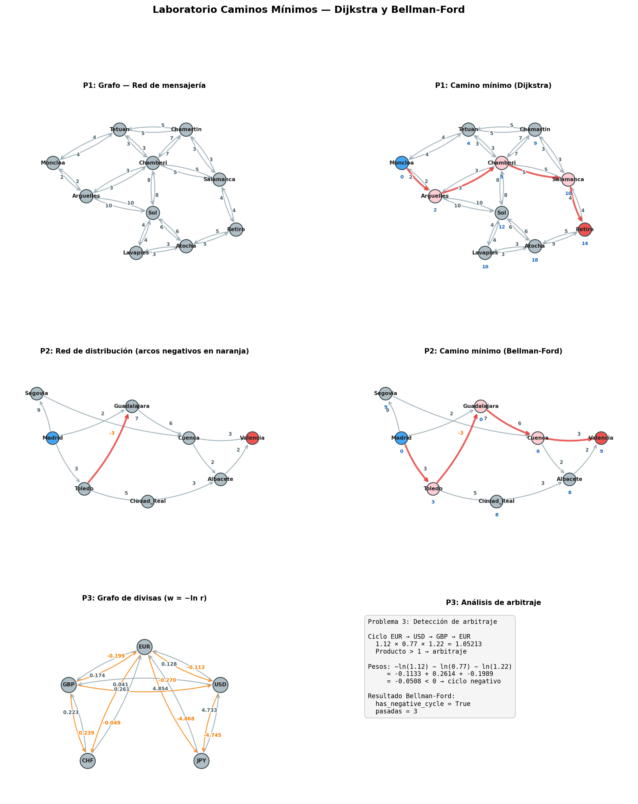
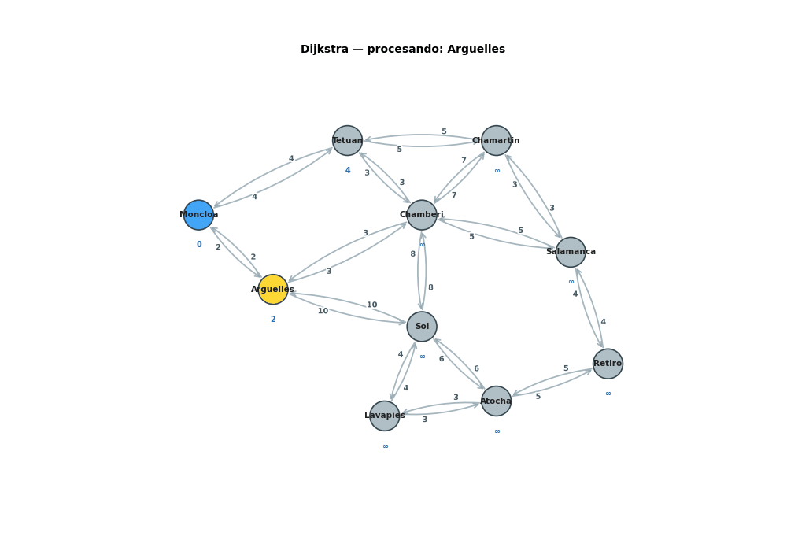
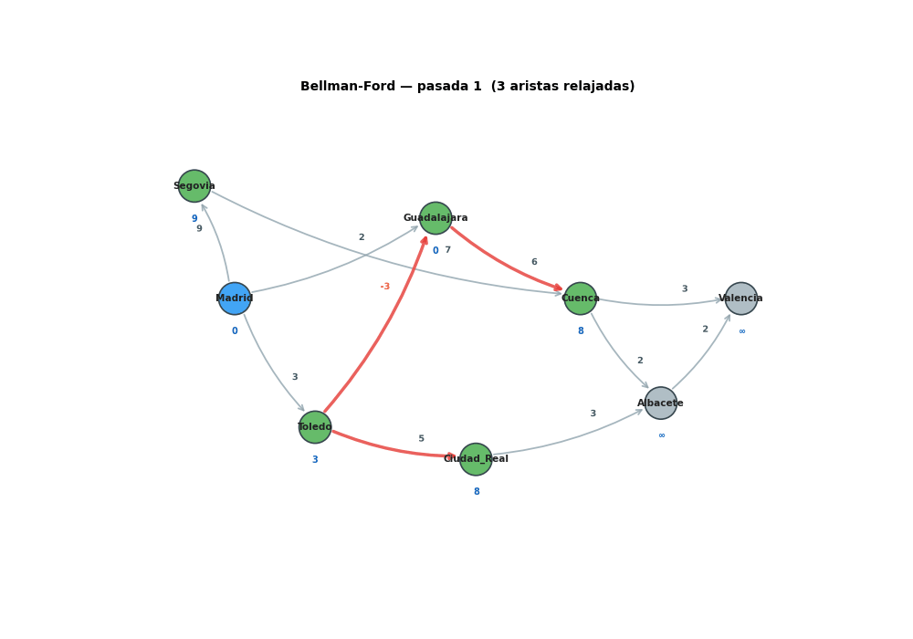

# Optimización en Redes y Detección de Arbitraje (Dijkstra & Bellman-Ford)

Implementación desde cero en Python de los algoritmos de caminos mínimos **Dijkstra** y **Bellman-Ford**, aplicados a problemas reales de logística urbana, distribución con costes negativos y detección de oportunidades de arbitraje en mercados de divisas.

## Casos de Uso Implementados

1. **Logística Urbana (Dijkstra):** Cálculo de la ruta más rápida en una red de mensajería en Madrid (pesos positivos).
2. **Red de Distribución con Carga de Retorno (Bellman-Ford):** Optimización de rutas interurbanas incorporando arcos con coste neto negativo (ingresos por transporte de retorno), demostrando la convergencia frente al fallo de Dijkstra.
3. **Detección de Arbitraje Cambiario:** Modelado de un grafo de divisas (`EUR`, `USD`, `GBP`, `JPY`, `CHF`) mediante transformación logarítmica (`w = -ln(r)`) para detectar ciclos negativos correspondientes a operaciones de arbitraje sin riesgo.

## Visualización de Resultados



### Ejecución paso a paso — Dijkstra (Red Urbana)


### Ejecución paso a paso — Bellman-Ford (Costes Negativos)


## Tecnologías
- **Python 3**
- **NumPy** & **Matplotlib** (visualización estática y generación de animaciones GIF)

## Cómo ejecutarlo
```bash
pip install numpy matplotlib pillow
python test_env_caminos.py
```
